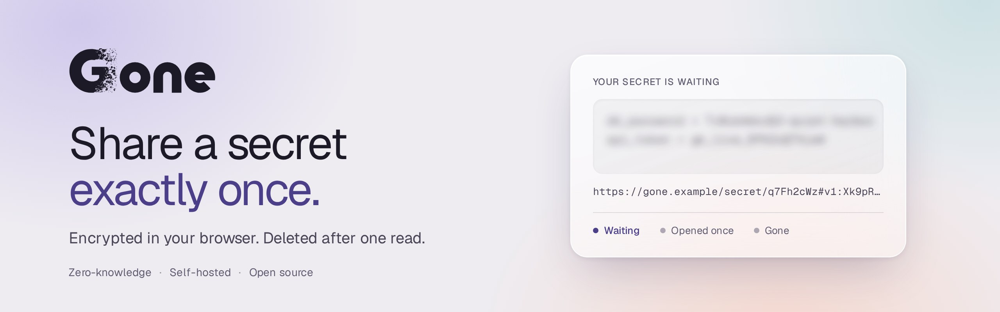
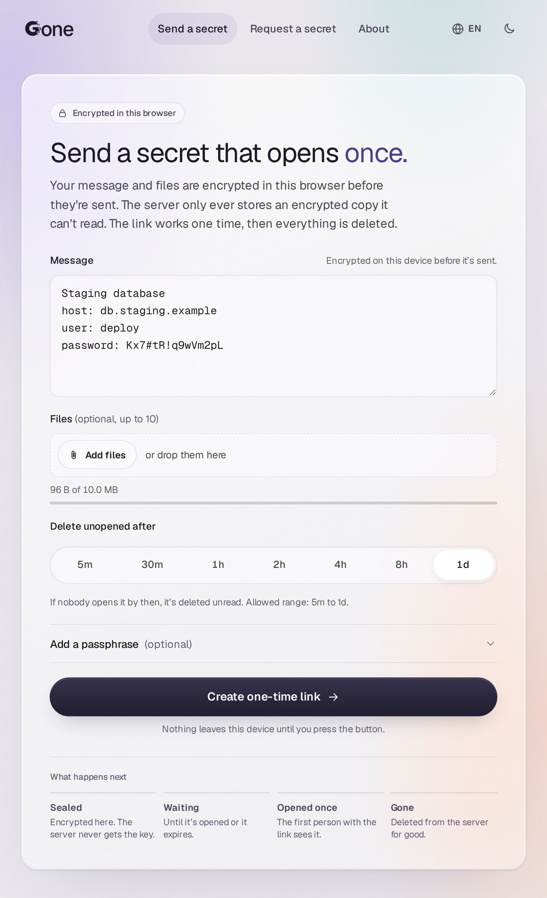
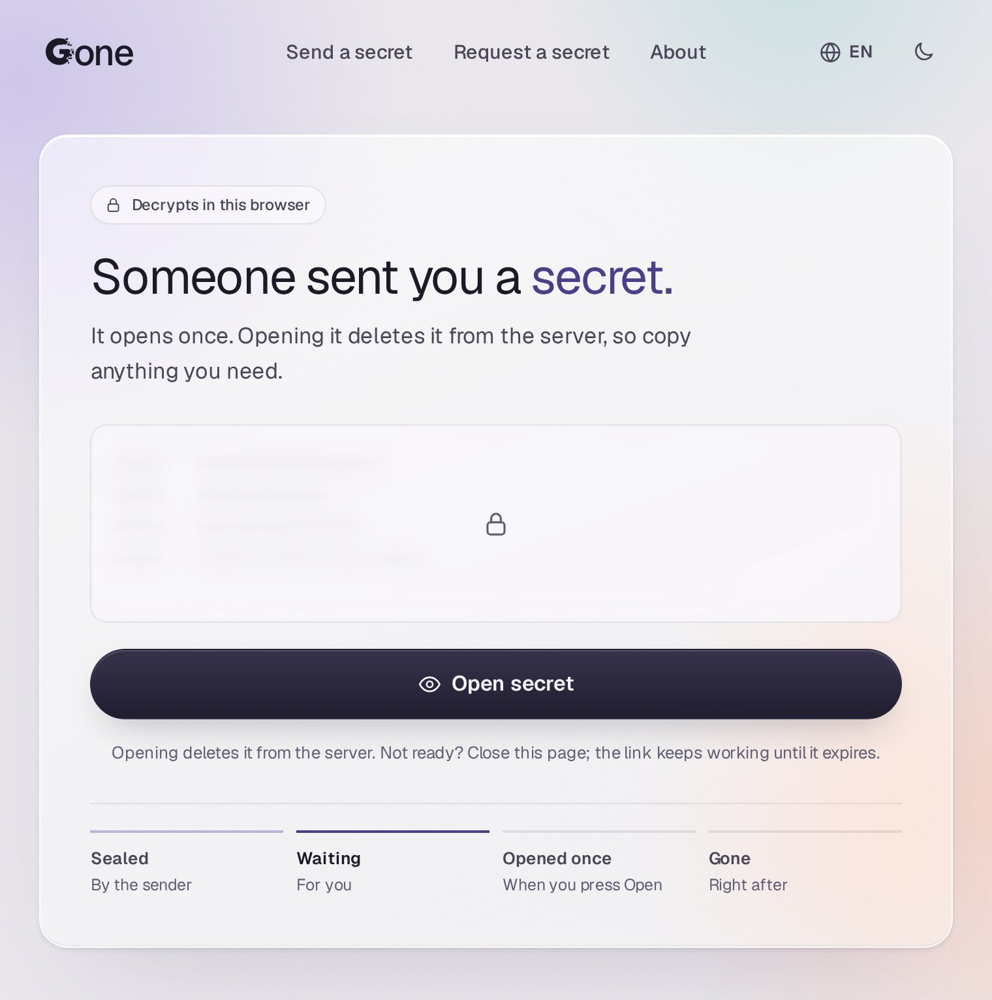
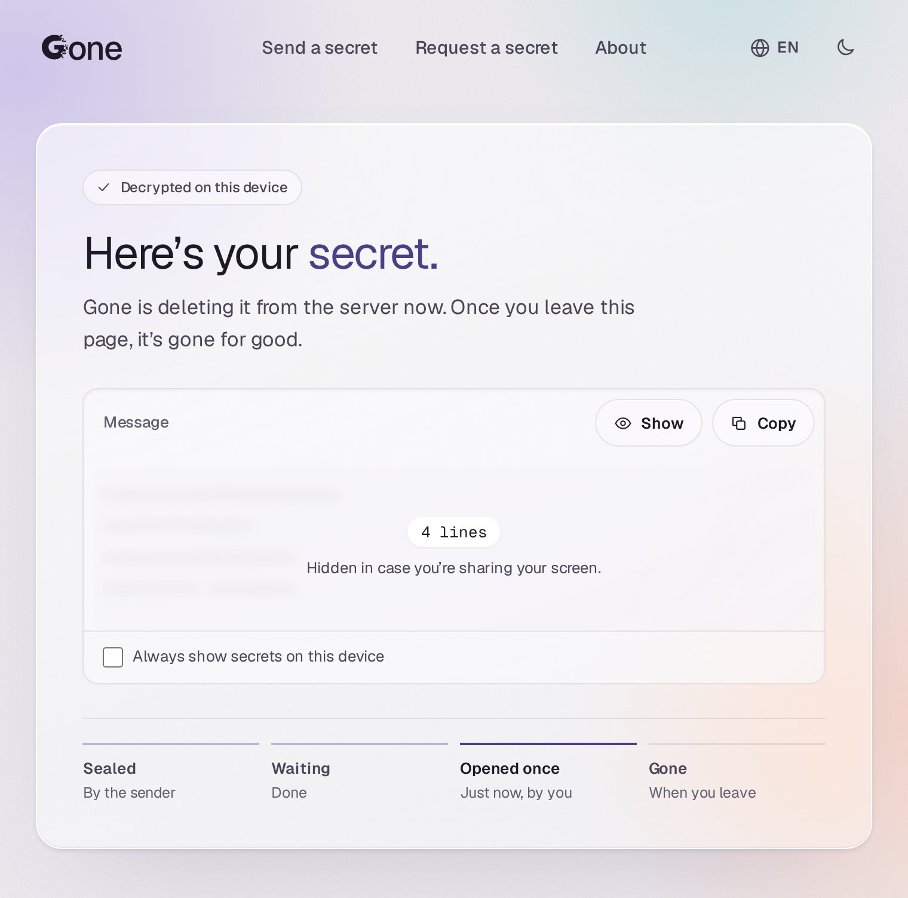
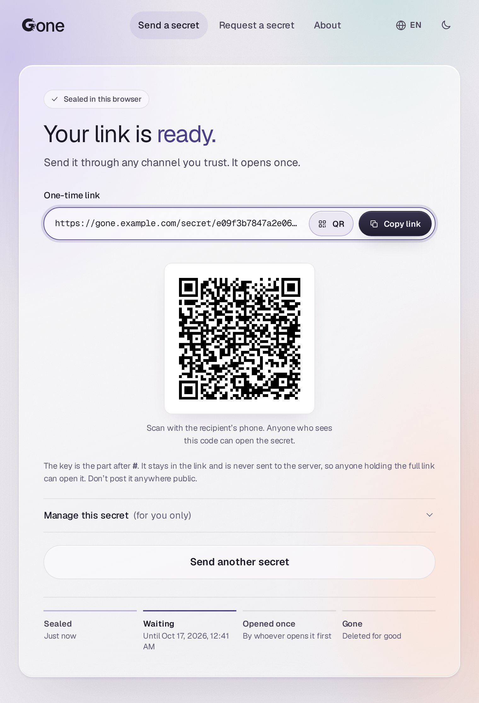
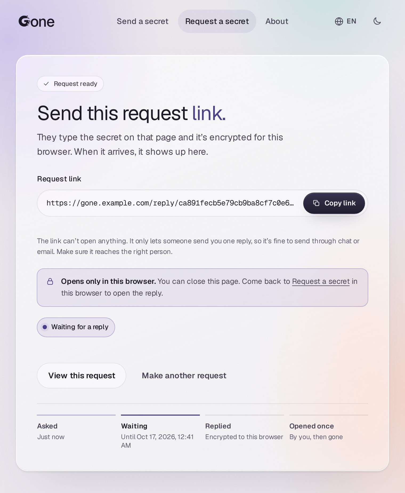

<picture>
  <source media="(prefers-color-scheme: dark)" srcset="docs/brand/hero-dark.jpg">
  
</picture>

[](https://github.com/haukened/gone/actions/workflows/build.yaml)
[](https://github.com/haukened/gone/actions/workflows/sec.yaml)
[](https://scorecard.dev/viewer/?uri=github.com/haukened/gone)
[](https://www.bestpractices.dev/projects/15214)
[](https://app.codacy.com/gh/haukened/gone/dashboard?utm_source=gh&utm_medium=referral&utm_content=&utm_campaign=Badge_grade)
[](https://app.codacy.com/gh/haukened/gone/dashboard?utm_source=gh&utm_medium=referral&utm_content=&utm_campaign=Badge_coverage)

[](https://github.com/haukened/gone/releases/latest)


*Because security shouldn't live behind paywalls.*

Go + One = Gone — a tiny service for sharing a secret exactly once.

Gone lets you paste a sensitive value (password, token, wifi key), generate a one‑time link, and send that link. The first person to open it sees the secret; after that it’s gone for good.

**Try it:** [app.getgone.dev](https://app.getgone.dev), a public instance run by the maintainer. Secrets can be up to 10 MB and are deleted after a day if nobody opens them. No uptime guarantee; limits may change.

<table>
<tr>
<td width="33%" valign="top"><a href="docs/img/send-light.jpg"><picture><source media="(prefers-color-scheme: dark)" srcset="docs/img/send-dark.jpg"></picture></a></td>
<td width="33%" valign="top"><a href="docs/img/open-light.jpg"><picture><source media="(prefers-color-scheme: dark)" srcset="docs/img/open-dark.jpg"></picture></a></td>
<td width="33%" valign="top"><a href="docs/img/revealed-light.jpg"><picture><source media="(prefers-color-scheme: dark)" srcset="docs/img/revealed-dark.jpg"></picture></a></td>
</tr>
<tr>
<td align="center"><b>Send</b><br>Encrypted in your browser</td>
<td align="center"><b>Open</b><br>One click, then it's deleted</td>
<td align="center"><b>Read</b><br>Hidden until you show it</td>
</tr>
<tr>
<td width="33%" valign="top"><a href="docs/img/qr-light.jpg"><picture><source media="(prefers-color-scheme: dark)" srcset="docs/img/qr-dark.jpg"></picture></a></td>
<td width="33%" valign="top"><a href="docs/img/request-light.jpg"><picture><source media="(prefers-color-scheme: dark)" srcset="docs/img/request-dark.jpg"></picture></a></td>
<td width="33%" valign="top"></td>
</tr>
<tr>
<td align="center"><b>Hand it over</b><br>Copy the link, or show a QR code</td>
<td align="center"><b>Request</b><br>Ask someone for a secret</td>
<td></td>
</tr>
</table>

---

## Quick start

```sh
docker run --rm -p 8080:8080 ghcr.io/haukened/gone:latest
```

Visit http://localhost:8080, type a secret or attach files, pick an expiry, and send the link. The recipient opens it once; the server deletes it as soon as their browser confirms it received everything.

> [!IMPORTANT]
> **Gone needs HTTPS.** Browsers only allow the encryption Gone uses on secure pages, so `http://localhost` works on the machine running Gone and nowhere else. To run it for real, use the ready-made [Docker Compose and Caddy setup](docs/deploy/compose.md), which gets a certificate on its own, or put it [behind your own reverse proxy](docs/deploy/reverse-proxy.md).

## How it works

1. You type a secret or attach files (up to 10, sharing the 10 MB default limit) and choose how long the link should live. The shortest choice is preselected.
2. Your browser encrypts everything before it leaves your machine. The server stores only the encrypted blob and when to delete it.
3. You get a link like `https://example/secret/abcd#v1:KEY`. The key is the part after `#`, which browsers never send to a server.
4. The recipient opens the link. The page removes the key from the address bar as soon as it has read it. Their browser downloads the blob, decrypts it locally, and tells the server to delete it.
5. A refresh or second visit finds nothing: the secret is gone.

Guarantees, in simple terms:
- The server never learns the plaintext.
- A link works once. Expired or used links are dead.
- With a passphrase, a leaked link alone can't open the secret.
- Your manage link can never reveal the secret. Once the secret is opened, deleted or expired, the server keeps no record that it existed.
- A request's reply opens only in the browser that asked for it; its private key never leaves that browser.

## Features

- **Files:** attach any type of file; names and types are encrypted too.
- **Passphrase:** a second lock. Type one or press **Generate** for five random words, and send it separately from the link.
- **Manage link:** see whether your secret is still waiting, and delete it before anyone opens it.
- **Request a secret:** ask someone for a secret. Your browser makes a key pair and gives you a link to send them; what they type is encrypted to your browser and opens only there.
- **QR code:** handing a link over in person? Press **QR** next to **Copy link**. Request links never get one: a QR code hides the address it opens, which makes it easy to fake.
- **Covered until shown:** an opened message stays hidden until the recipient presses **Show**, for screen sharing.
- **Languages:** English, Spanish, French, German and Brazilian Portuguese.
  - The first visit follows the browser's languages. A regional variant falls back to its language, so `es-MX` gets Spanish and `pt-PT` gets Brazilian Portuguese; anything else gets English.
  - The globe button switches the language in place, without losing what's on the page. The choice is kept in a `gone_lang` cookie that holds only the language.
  - Translations other than English are machine-made; [corrections are welcome](CONTRIBUTING.md#translations).
- **Self-hosted:** one static binary or a small container, SQLite storage, no external services, and a strict Content Security Policy. Nothing loads from anywhere but your server, and every page asks search engines not to list it.
- **Your rules:** an operator can require a passphrase on every secret, and limit or turn off attachments. See [Policies](docs/configuration.md#policies).
- **Your name on it:** an operator can show their own name, logo and accent colour, and link their contact, imprint and privacy pages, with "Powered by Gone" kept in the footer. See [Branding your instance](docs/branding.md).
- **Private instances:** require sign-in through your own proxy (oauth2-proxy, Authelia and others; Cloudflare Access, Pomerium and more are built but not yet tested live) to create secrets, while anyone with a link can still open it. Gone checks the proxy's signed token or trusted header and never records who. See [Sign-in for private instances](docs/sign-in.md).

### From the command line

The `gone` CLI does the same from a terminal and works with secrets sent from the browser, and the other way round. On Linux or macOS, install it with:

```sh
curl -fsSL https://raw.githubusercontent.com/haukened/gone/main/install.sh | sh
```

The script checks the download against the release's checksums (and its signed provenance, if the GitHub CLI is signed in) and installs into `~/.local/bin` without sudo. There are also `.deb` and `.rpm` packages and archives for Linux, macOS and Windows on the [releases page](https://github.com/haukened/gone/releases); see [installing the CLI](docs/cli.md#install).

```sh
printf 'hunter2' | gone send --ttl 30m              # prints the link and your manage link
gone get 'https://app.getgone.dev/secret/AbC#v1:…'  # quote links in single quotes
gone request --label 'VPN key'                      # ask someone for a secret
printf 'hunter2' | gone reply '<request-link>'      # answer someone's request
```

`gone` opens only links from the server you use (`https://app.getgone.dev` until you run `gone set server`); a link for any other server is refused before anything is sent, unless you pass `--allow-origin` for that command. Messages come from standard input, never from arguments. Scripts and AI agents can handle secrets by reference, so the plaintext never appears in their output. The full guide is [docs/cli.md](docs/cli.md).

## Documentation

| | |
| --- | --- |
| **Questions** | [FAQ](docs/faq.md) |
| **Use the CLI** | [Guide](docs/cli.md) · [Reference](docs/cli-reference.md) |
| **Self-host** | [Overview](docs/deploy/README.md) · [Compose with Caddy](docs/deploy/compose.md) · [Docker](docs/deploy/docker.md) · [Kubernetes](docs/deploy/kubernetes.md) · [Linux packages](docs/deploy/packages.md) · [Reverse proxy](docs/deploy/reverse-proxy.md) · [Configuration](docs/configuration.md) · [Metrics](docs/metrics.md) · [Upgrade and maintain](docs/operating.md) |
| **Trust it** | [Security model](docs/security.md) · [Verify a release](docs/verify.md) · [Reporting a vulnerability](SECURITY.md) |
| **Write a client** | [HTTP API](docs/api.md) ([OpenAPI](docs/openapi.yaml)) · [Protocol](docs/protocol.md) |
| **Build it** | [Contributing](CONTRIBUTING.md) · [Development](docs/development.md) · [Roadmap](docs/ROADMAP.md) · [Rejected features](docs/rejected.md) · [Technical decisions](docs/decisions.md) |

The full index is [docs/README.md](docs/README.md).

## Contributing and support

- **Report a bug or request a feature:** [open an issue](https://github.com/haukened/gone/issues/new/choose). Issues are public and searchable. Check [rejected features](docs/rejected.md) first.
- **Report a vulnerability:** privately, as described in [SECURITY.md](SECURITY.md). Never in a public issue.
- **Contribute:** read [CONTRIBUTING.md](CONTRIBUTING.md) for the pull request process and the coding, testing and documentation requirements.

## License

Copyright © 2025-2026 The Gone Project Contributors.

GNU Affero General Public License v3.0; see [`LICENSE`](LICENSE).

The "Gone" name, wordmark and logo are trademarks and are not licensed under the AGPLv3. Forks and modified versions must use a different name and logo; see [`TRADEMARKS.md`](TRADEMARKS.md).
