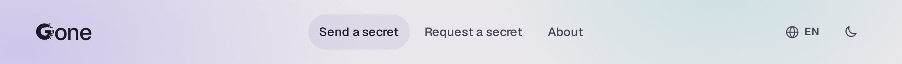
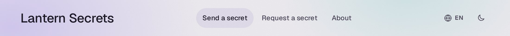
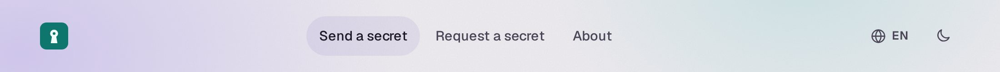
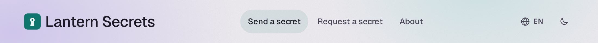
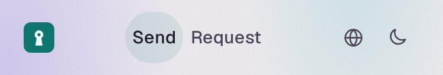
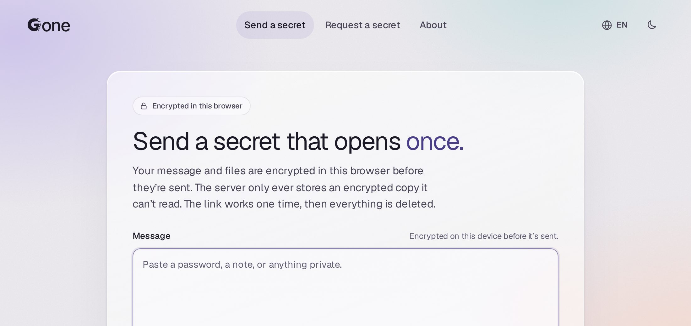
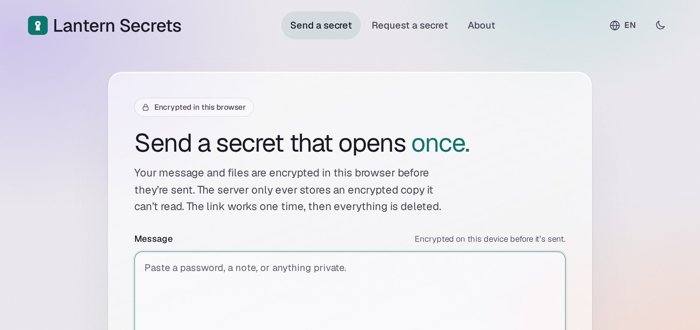
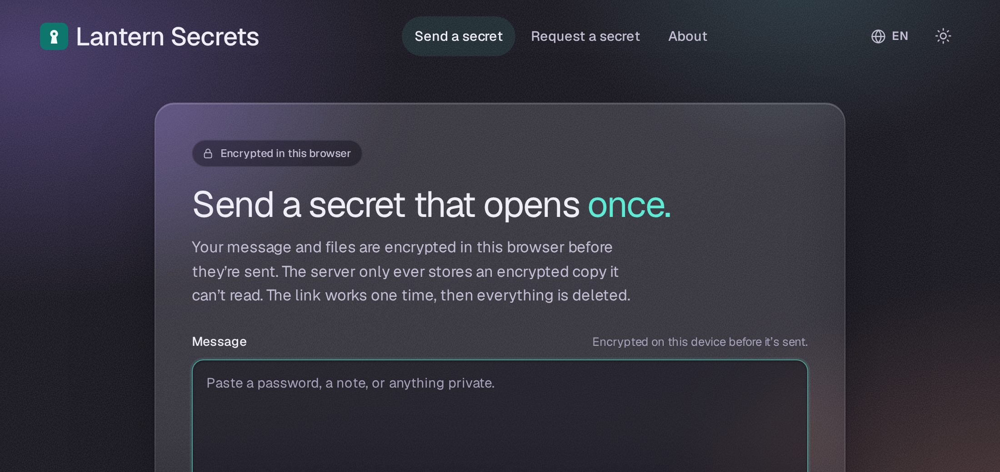
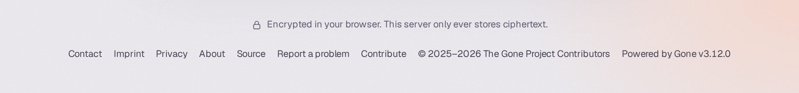
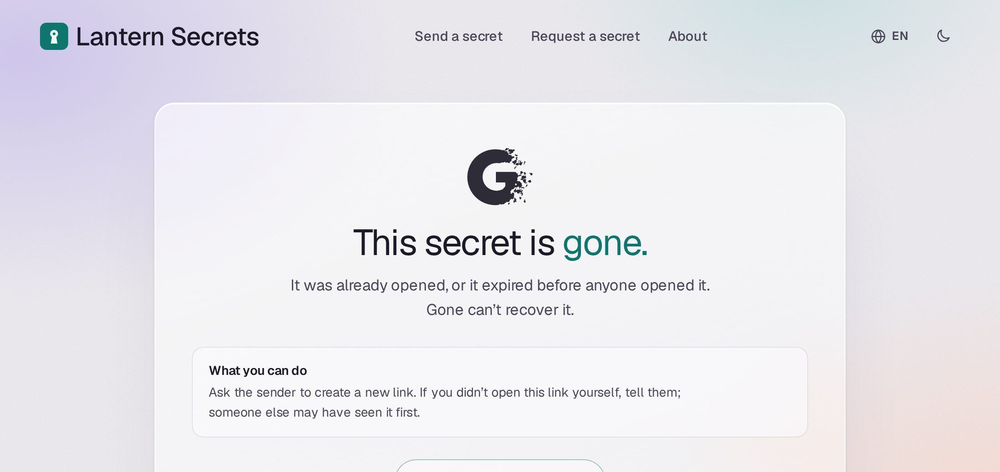

# Branding your instance

You can show your own name, logo and accent colour on an unmodified copy of Gone, and link your contact, imprint and privacy pages from the footer. Each setting is an environment variable, each is optional, and each works on its own. With none of them set, Gone looks exactly as it always has.

The screenshots on this page use a made-up brand, "Lantern Secrets", with [this example logo](img/branding/example-logo.svg).

> [!IMPORTANT]
> **The Gone footer can't be removed.** On a branded instance the footer's version line reads "Powered by Gone" and the version. That line, the copyright notice and the Source, Report a problem and Contribute links always stay. There is no setting to hide them, and the [trademark policy](../TRADEMARKS.md) allows branding only while "Powered by Gone" remains. Your own links are added in front of them; see [Footer links](#footer-links).

## Name

```sh
GONE_BRAND_NAME="Lantern Secrets"
```

The name replaces the Gone wordmark in the header. It can be up to 40 characters, and commas are fine.

Without branding:



With `GONE_BRAND_NAME`:



## Logo

```sh
GONE_BRAND_LOGO=/brand/lantern-logo.svg
```

The value is a path to an SVG or PNG file of at most 256 KiB. On its own, the logo replaces the wordmark and links home:



With a name as well, the logo comes first:



On screens narrower than 40rem the logo stands alone, so the links keep their room. Screen readers still hear "Lantern Secrets, home". A name without a logo is shortened with an ellipsis instead.



- **Size.** The logo is drawn a little taller than the header text and at most about five times as wide as it is tall. A wide logo that already spells out your name works without `GONE_BRAND_NAME`.
- **Formats.** An SVG must have an `<svg xmlns="http://www.w3.org/2000/svg">` root element. JPEG, WebP and other formats are refused at startup.
- **Changes.** The file is read once at startup and served from memory at `/brand/logo`, so a new logo takes a restart.
- **Safety.** An SVG is shown with ``, where its scripts never run, and is served with a sandboxed Content Security Policy of its own in case someone opens it directly.
- **Containers.** The container runs as user 65532, so the file must be readable by it. Mount it read-only; see [Everything together](#everything-together).

## Accent colour

```sh
GONE_BRAND_ACCENT="#0f766e/#5eead4"
```

Two colours, `#light/#dark`: the first for the light theme, the second for the dark theme. They replace Gone's violet in the highlighted word of each heading, focus rings, progress bars, links on the About page, and the soft tints such as the current page's tab. Buttons, text, the glass panes and the backdrop keep Gone's colours.

Without branding, with the message box focused:



With `GONE_BRAND_ACCENT`, light theme:



Dark theme:



**Contrast.** The accent is used for text, so when the server starts it checks each colour against its theme's backgrounds. It refuses a colour below 4.5:1 (WCAG AA), and names the setting and the measured ratio:

```text
load config: GONE_BRAND_ACCENT: the light-theme colour #ffff00 has a contrast of 1.01:1 on that theme's background; it needs at least 4.5:1
```

A mid-tone that suits the light theme is usually too dark for the dark theme, which is why there are two values. A darker shade of your brand colour for the light theme and a lighter one for the dark theme usually pass. Gone's own accent is `#4b3f8a/#cfc6f7`.

## Footer links

```sh
GONE_CONTACT_URL=mailto:help@lantern.example
GONE_IMPRINT_URL=https://lantern.example/imprint
GONE_PRIVACY_URL=https://lantern.example/privacy
```

Each setting adds a link at the start of the footer. Contact may be an `https://` URL or a `mailto:` address; Imprint and Privacy must be `https://`. Operators in the EU are often required to publish an imprint and a privacy notice, and these settings link them from every page.

Without branding:


With the three links, plus a name, logo or accent:



The labels follow the visitor's language:

| Language | Contact | Imprint | Privacy |
| -------- | ------- | ------- | ------- |
| English | Contact | Imprint | Privacy |
| Spanish | Contacto | Aviso legal | Privacidad |
| French | Contact | Mentions légales | Confidentialité |
| German | Kontakt | Impressum | Datenschutz |
| Portuguese (Brazil) | Contato | Informações legais | Privacidade |

Footer links on their own don't brand the instance: the header keeps the Gone wordmark, and the version line keeps reading "Gone" and the version. Once a name, logo or accent is set, the version line reads "Powered by Gone". As the note at the top says, the Gone parts of the footer stay either way.

## What stays Gone

Branding changes the header, the accent colour and the start of the footer. Everything that describes the software keeps calling it Gone:

- **The footer:** "Powered by Gone" and the version, the copyright notice, and the Source, Report a problem and Contribute links.
- **Browser tab titles,** such as "Gone · Send a one-time secret".
- **The favicon** and the home-screen icon.
- **The About page,** which explains how Gone keeps a secret.
- **Page text** that names the software, such as "Gone can't recover it", in every language.
- **The large G** on the screens that say a secret or request is gone:



## Everything together

```yaml
services:
  gone:
    image: ghcr.io/haukened/gone:v3.12.0
    environment:
      GONE_BRAND_NAME: "Lantern Secrets"
      GONE_BRAND_LOGO: /brand/lantern-logo.svg
      GONE_BRAND_ACCENT: "#0f766e/#5eead4"
      GONE_CONTACT_URL: mailto:help@lantern.example
      GONE_IMPRINT_URL: https://lantern.example/imprint
      GONE_PRIVACY_URL: https://lantern.example/privacy
    volumes:
      - ./lantern-logo.svg:/brand/lantern-logo.svg:ro
```

A setting that fails its check stops the server at startup with an error that names the variable, so a typo never goes live quietly. The full rules for each variable are in [Configuration](configuration.md#server-variables).
